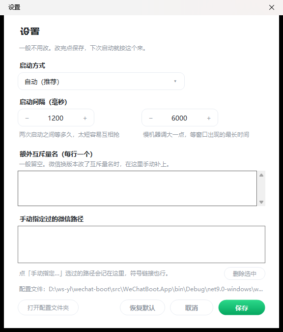

<div align="center">


# 微信多开启动器

**点一下，同时开好几个微信。340KB，绿色免安装。**

不注入 · 不 Hook · 不改微信客户端 · 不要管理员权限

[](#)
[](#)
[](#-许可)
[](https://github.com/r0ad/wechat-boot/releases/latest)

[**⬇ 下载**](https://github.com/r0ad/wechat-boot/releases/latest) · [原理](#-它怎么做到的) · [常见问题](#-常见问题) · [开发者文档](AGENTS.md)

</div>


## 🚀 三步就能用

1. **双击** `WeChatBoot.exe`
2. 选好微信版本，把数量点成 **3**
3. 点绿色按钮 **「打开 3 个微信」** —— 三个登录窗口一起出现，各自扫码就行

没有配置文件要改，没有参数要背。想改启动间隔、重试时间这些，点右上角「设置」：



## ⬇ 下载

到 [Releases](https://github.com/r0ad/wechat-boot/releases/latest) 挑一个：

| 版本 | 体积 | 需要装 .NET 吗 | 适合谁 |
| --- | --- | --- | --- |
| **`WeChatBoot-win-x64-standalone.zip`**（推荐） | ~52 MB | ❌ 不用 | 不想装运行时的绝大多数人 |
| `WeChatBoot.exe` | ~340 KB | ✅ 需要 [.NET 9 桌面运行时](https://dotnet.microsoft.com/download/dotnet/9.0) | 电脑里已经有 .NET 9 的人 |

> 都是单文件绿色版，解压/拷到哪都能跑，不写注册表、不装服务。

## ✨ 为什么用它

- **一次点一下，开够就停**：按「还要开几个」算，不会像别的脚本那样反复把已经开着的窗口再拉一遍。
- **你关掉的不会被补回来**：中途觉得多了，随手关掉一个窗口，工具不会自作主张又给你开一个。
- **不会被假成功骗到**：微信被单实例机制挡下时会先闪一个窗口再自杀。本工具要等窗口**稳定存活 5 秒**才算成功，失败会直说原因。
- **自动找微信**：注册表 → 正在运行的进程 → 常见安装目录，三路一起找；找不到还能「手动指定」，路径会记住。
- **多版本共存**：同时装了 4.2 和 3.9 也分得清，实例数不会互相算错（按安装目录分组）。
- **零依赖、无侵入**：纯 C# + Win32 调用，没有第三方包；不注入、不 Hook、不改微信任何文件，微信检测不到「客户端被改」。
- **有日志可查**：`wechatboot.log` 跟配置放一起，出问题直接发日志，不用截图猜。

## 🔍 它怎么做到的

微信判断「是不是已经有一个我在跑」，靠的是一个**会话级命名互斥量**：

- 名字拿到了 → 把已有窗口还原到前台，自己退出（**不报错**，这就是「微信已在运行」的全部表现）
- 名字没拿到（`ERROR_ACCESS_DENIED`）→ 单实例判断落空，正常启动

本工具的做法：**先自己占住那个互斥量**，把它的 DACL 改成 Deny Everyone，再启动微信。微信拿不到「已存在」，也就不会折叠。

互斥量名不写死，会从正在运行的微信进程句柄表里**自动发现**：

| 版本 | 名字 |
| --- | --- |
| 3.x | `_WeChat_App_Instance_Identity_Mutex_Name` |
| 4.0.2+ | `XWeChat_XWEB_Instance_Identity_Mutex_Name` |

更完整的原理、失败模式时间线、踩过的坑：[AGENTS.md](AGENTS.md) · [docs/mechanism.md](docs/mechanism.md)

## ✅ 兼容性（本机实测）

| 微信版本 | 多开 | 说明 |
| --- | --- | --- |
| 4.2.0.51 | ✅ | 3 个实例稳定共存，长时间观察正常 |
| 4.1.15.56 | ✅ | 与 4.2 可同时运行 |
| 3.9.12.55 | ⚠️ | 能开出第二个，但 3.x 还有一层窗口检测，约 2 秒后自退 —— 如实标注为「半可用」，不做 hack |

## ❓ 常见问题

**要管理员权限吗？**
不要。全程普通用户权限。

**会不会改坏我的微信 / 被检测到？**
不会。工具只在**内核对象层面**操作，不写微信目录、不改文件、不注入进程、不 Hook。微信看到的是一个正常的第二个自己。

**为什么开出来的微信都要扫码？**
多开只是让多个实例同时运行，登录态各自独立。同一账号的「免扫码」凭据只有一份，这个工具不碰登录数据，也不该碰。

**开出来的窗口过几分钟自己关了？**
微信侧行为：**未登录**的实例闲置一段时间可能自行退出。尽快扫码登录即可；遇到就「全部关闭」重开。

**为什么 3.x 只能算「半可用」？**
3.x 除了互斥量还有 `FindWindow` 二次检查。要绕过就得改客户端或注入，本工具选择不做。

**杀毒软件提示风险？**
单文件 exe 由 .NET 打包，部分杀软对「未签名的小工具」敏感。可以自行从源码编译（见下），或把文件加入信任。

**支持 macOS / Linux 吗？**
不支持。Windows 专属（Win32 窗口 + 命名内核对象）。

## 🛠 自己编译

```bash
git clone https://github.com/r0ad/wechat-boot.git
cd wechat-boot
dotnet build WeChatBoot.sln -c Release          # 需要 .NET 9 SDK
scripts/build-release.cmd                        # 产出 dist/WeChatBoot.exe
```

想验证核心逻辑（不开界面）：`dotnet run --project tools/WeChatBoot.Probe -- instances`

## 📁 仓库结构

```
src/WeChatBoot.Core/   核心：寻址、实例计数、互斥量布防、启动编排
src/WeChatBoot.App/    WinForms 界面（单文件 exe 入口）
tools/WeChatBoot.Probe/ 无界面诊断探针
docs/                  原理、实测记录、调研笔记
```

细节与约定见 [AGENTS.md](AGENTS.md)。

## ⚠️ 免责声明

仅供个人在**自己设备**上同时登录多个微信账号使用。请遵守 [微信软件许可及服务协议](https://weixin.qq.com/agreement)。使用本工具产生的任何后果（包括但不限于账号限制）由使用者自行承担，作者不承担任何责任。

本项目与腾讯公司无关，未获得其授权或认可。

## 📄 许可

[MIT](LICENSE)
