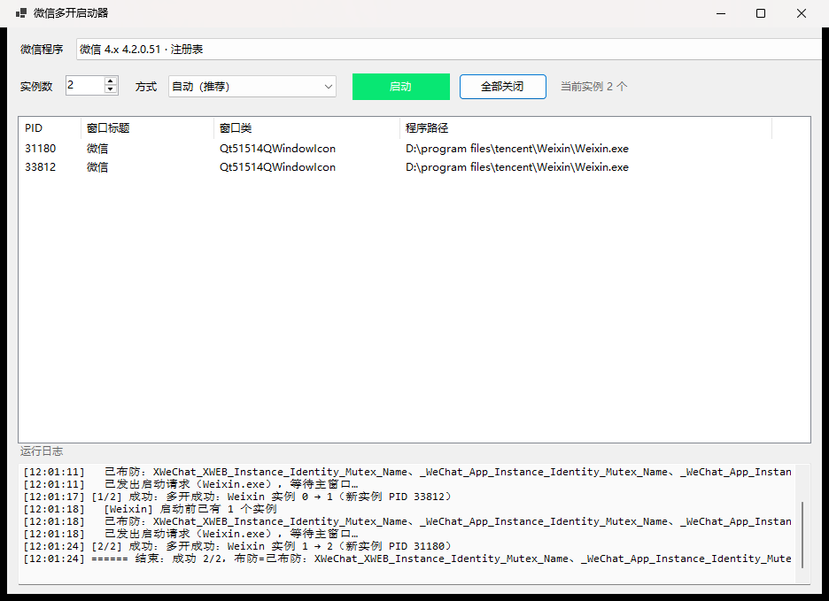

# 微信多开启动器（WeChatBoot）

一个 Windows 桌面小工具：双击就能把微信同时开成多个窗口，用来同时登录多个账号。



## 特性

- **自动寻址**：注册表 → 运行中的进程 → 常见安装目录，把本机所有微信（3.x / 4.x，多个版本共存也行）都扫出来。
- **手动维护**：扫不到就点「手动指定…」，选一次 `Weixin.exe` 即可；路径会记住，下次直接可选。
- **按安装区分**：本机同时装了 4.1 和 4.2 时，两个 `Weixin.exe` 不会互相算错实例数。
- **实例列表实时刷新**：PID / 窗口标题 / 窗口类 / 路径一目了然，2 秒自动刷新。
- **启动结果如实校验**：微信被单实例机制“折叠”时会先闪一个窗口再退出，工具不会被这个假象骗到，日志里能看出到底成没成。
- **零依赖**：纯 C# + Win32 P/Invoke，没有第三方包，不改微信客户端文件、不注入、不 Hook。
- **便携配置**：配置就写在 exe 旁边的 `wechatboot.config.json`（目录不可写时退回 `%APPDATA%\WeChatBoot`）。

## 用法

1. 双击 `WeChatBoot.exe`（或 `dotnet run --project src/WeChatBoot.App`）。
2. 顶部选择要启动的微信（自动列出本机所有安装）。
3. 选「实例数」——本次一共要开几个窗口（含已经在运行的那个）。
4. 「方式」保持 **自动** 即可。
5. 点「启动」，看日志；下方列表出现多个实例即成功。

> 每个新实例都会停在扫码/登录页，分别登录不同账号即可。
> 「全部关闭」会结束所有微信进程，没发出去的消息仍保存在服务器草稿里。

## 原理

微信靠一个**会话级命名互斥量**判断“是否已有实例在跑”：
`CreateMutex` 返回 `ERROR_ALREADY_EXISTS` 时，它把已有窗口还原到前台然后自杀——这就是“多开失败”的全部表现。

- 3.x：`_WeChat_App_Instance_Identity_Mutex_Name`
- 4.x：`XWeChat_XWEB_Instance_Identity_Mutex_Name`（4.0.2 起改名，之前的 4.0.1 用 `Lock.ini` 文件锁）

工具的做法（`MutexGuard`）：

1. 自己 `CreateMutex` 占住同名对象，用 `SetSecurityInfo` 把 DACL 改成 **Deny Everyone**；
2. 于是微信调用 `CreateMutex` 拿到的是 `ERROR_ACCESS_DENIED` 而不是 `ERROR_ALREADY_EXISTS`，单实例判断落空，正常启动；
3. 布防期间（整个启动过程）工具必须一直持有句柄——ACL 只在有进程持有对象时存在。

名字不是写死的：`MutexGuard.DiscoverIdentityMutexNames()` 会从正在运行的微信进程句柄表里把带 `Instance_Identity_Mutex` 的对象名捞出来，所以微信以后再改名也能兜住（兜不住时还能在配置里手动加 `ExtraMutexNames`）。

更细的实测记录（各种失败模式、时间线、为什么稳定性窗口必须是 5 秒）见 [docs/mechanism.md](docs/mechanism.md)，原始资料调研见 [docs/research/wechat-multi-instance.md](docs/research/wechat-multi-instance.md)。

## 实测环境与已知限制

| 项 | 结果 |
| --- | --- |
| 微信 4.2.0.51（`D:\Program Files\Tencent\Weixin`） | ✅ 2 个实例稳定共存（自动方式，界面实测） |
| 微信 3.9.12.55（`D:\Program Files\Tencent\WeChat`） | ⚠️ 第二个实例能起来，但微信还有一层 `FindWindow` 二次检查，约 2 秒后自行退出——3.x 多开属“半可用”，如实标注，不做 hack |
| 微信 4.1.15.56 与 4.2.0.51 同时安装 | ✅ 两个版本可各自运行（不同安装目录天然独立） |
| 免扫码登录 | ❌ 多开出来的实例都要单独扫码；同一账号的“全局免扫码”只有一份设备凭据 |

其他说明：

- 微信 4.x 对“客户端被改过”敏感（会提示“由于环境异常，不能继续使用”），本工具不修改任何微信文件，规避了这类风险。
- 部分版本存在“最多 4 个”之类的官方限制，超出后新实例登录会被拒绝，这与多开工具无关。
- 需要 Windows 10/11 + .NET 9 桌面运行时（源码可用 `dotnet build` 直接编译）。

## 源码结构

```
src/WeChatBoot.Core/      # 全部逻辑，无 UI 依赖
  NativeMethods.cs        # Win32 P/Invoke
  WeChatLocator.cs        # 自动寻址：注册表 / 进程 / 目录扫描
  InstanceManager.cs      # 实例枚举（按主窗口，不按进程数）
  MutexGuard.cs           # ACL 布防 + 互斥量名自动发现
  HandleScanner.cs        # 遍历句柄表、关闭单实例互斥量（兜底策略）
  Launcher.cs             # 启动 + 结果校验 + 关全部
  AppConfig.cs            # 便携 JSON 配置
src/WeChatBoot.App/       # WinForms 界面（纯代码，无设计器）
tools/WeChatBoot.Probe/   # 无界面诊断探针：detect/instances/windows/mutants/guard/launch/close
docs/                     # 原理调研 + 实测记录 + 截图
```

## 构建

```bash
dotnet build WeChatBoot.sln -c Release
dotnet publish src/WeChatBoot.App -c Release -r win-x64 --self-contained false -p:PublishSingleFile=true -o dist
```

或直接运行 `scripts/build-release.cmd`，产物在 `dist\WeChatBoot.exe`（单文件，需已安装 .NET 9 桌面运行时）。

诊断探针（排查本机微信行为用）：

```bash
dotnet run --project tools/WeChatBoot.Probe -- detect
dotnet run --project tools/WeChatBoot.Probe -- instances
dotnet run --project tools/WeChatBoot.Probe -- guard --hold 5
dotnet run --project tools/WeChatBoot.Probe -- launch --count 2
```
