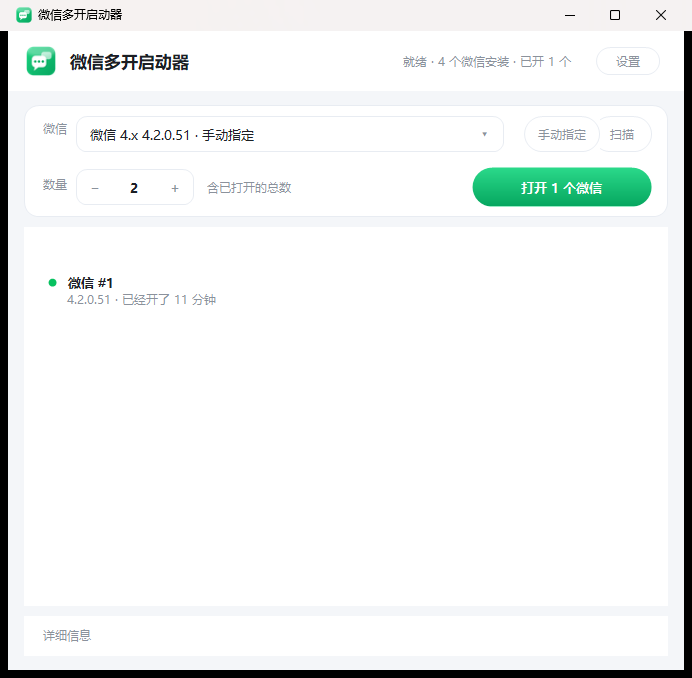

# 微信多开启动器（WeChatBoot）

一个 Windows 桌面小工具：双击打开，点一下绿色按钮，微信就能同时开好几个窗口，分别登录不同账号。



## 怎么用（三步）

1. **双击 `WeChatBoot.exe`** —— 工具会自己把本机所有微信找出来（3.x / 4.x、装在 C 盘 D 盘都行、多个版本共存也行）。
2. **选数量** —— 「数量」填本次**一共**要开几个（含已经开着的那个）。
3. **点「打开 N 个微信」** —— 每个新窗口停在扫码页，各自登录即可。

按钮上的数字是「还要开几个」：已经开着 2 个、你填 3，它就写「打开 1 个微信」；填的数字不大于已开数量时，按钮会写「已经开着，不用重复打开」。

列表实时显示已经开了几个、是什么版本、开了多久。不想开了点「全部关闭」。

> 不用改任何设置。设置里那些东西，只有想折腾的时候才需要动。

## 界面上的三块

| 区域 | 说明 |
| --- | --- |
| 顶部操作卡 | 「微信」下拉列出本机所有安装；「手动指定…」用来加扫描不到的；「扫描」重新找一遍；「数量」+ 绿色按钮负责开 |
| 实例列表 | 按**主窗口**计数的真实实例（不是进程数——一个微信会开十几个进程）；切到托盘也照样算 |
| 详细信息 | 默认收起；展开能看到每一步在干什么、失败的确切原因 |

## 设置里有什么（默认值够用）

点右上角「设置」。只有点「保存」才生效，点「取消」一律不改。

| 项 | 默认 | 什么时候要动 |
| --- | --- | --- |
| 启动方式 | 自动（推荐） | 自动 = 先布防互斥量、不行再关句柄、最后直接启动。除非排查问题，否则不用动 |
| 启动间隔 | 1200 毫秒 | 两次启动之间的等待。太快容易互相抢，机器慢就调大 |
| 等待窗口超时 | 6000 毫秒 | 等新窗口出现的最长时间。老机器上开得慢就调大 |
| 额外互斥量名 | 空 | 微信换了新版本、改了互斥量名导致多开失效时，手工补一行 |
| 手动指定过的路径 | 空 | 「手动指定…」选过的路径会自动记在这里，可删 |

最下面是配置文件位置（`WeChatBoot.exe` 同目录的 `wechatboot.config.json`）和「打开配置文件夹」。

## 特性

- **自动寻址**：注册表 → 运行中的进程 → 常见安装目录，三路一起找。
- **手动维护**：扫不到就点「手动指定…」选一次 `Weixin.exe`，路径会记住。
- **按安装区分**：本机同时装 4.1 和 4.2 时，两个 `Weixin.exe` 的实例数不会互相算错。
- **不会被假成功骗到**：微信被单实例机制折叠时会先闪一个窗口再自杀，工具要等窗口稳定存活才判定成功（判据见下文「为什么等 5 秒」）。
- **零依赖**：纯 C# + Win32 P/Invoke，没有第三方包；不改微信文件、不注入、不 Hook。
- **点一次管一次**：按「要开几个」算差量，开够了就收手。中途你自己关掉一个窗口，它不会替你补回来（数量是你说了算）；开到一半后悔，按钮会变成「停止」。
- **便携配置**：配置写在 exe 旁边（目录不可写时退回 `%APPDATA%\WeChatBoot`）；窗口大小也会记住。
- **有日志可查**：界面「详细信息」里的内容同时写进 `wechatboot.log`（跟配置文件放一起，超过 512KB 自动重开），出问题直接发这个文件。

## 原理（一句话版）

微信靠一个**会话级命名互斥量**判断「是不是已经有一个我在跑」：`CreateMutex` 拿到 `ERROR_ALREADY_EXISTS` 就把旧窗口还原到前台、自己退出——这就是多开失败的全部表现。

本工具先占住那个互斥量，把它的 DACL 改成 **Deny Everyone**。于是微信再次 `CreateMutex` 拿到的是 `ERROR_ACCESS_DENIED` 而不是「已存在」，单实例判断落空，正常启动。

- 3.x 名字：`_WeChat_App_Instance_Identity_Mutex_Name`
- 4.x 名字：`XWeChat_XWEB_Instance_Identity_Mutex_Name`（4.0.2 起多了个 X 前缀）

名字不写死：`MutexGuard.DiscoverIdentityMutexNames()` 会从正在运行的微信进程句柄表里把带 `Instance_Identity_Mutex` 的对象名捞出来，微信以后再改名也能兜住；钓不到时还能在设置里手动加。

**为什么等 5 秒**：布防成功也不代表真成了——被折叠的实例会先出现窗口、2~3 秒后才消失。所以判定标准是「新实例出现并且稳定存活 5 秒」，中途消失了就判失败并说明原因。

更细的实测记录（各种失败模式、时间线、ACL 的两个坑）见 [docs/mechanism.md](docs/mechanism.md)，原始资料调研见 [docs/research/wechat-multi-instance.md](docs/research/wechat-multi-instance.md)。

## 实测环境与已知限制

| 项 | 结果 |
| --- | --- |
| 微信 4.2.0.51（`D:\Program Files\Tencent\Weixin`） | ✅ 2 个实例稳定共存（界面实测，保持启动器开着观察 >2 分钟） |
| 微信 3.9.12.55（`D:\Program Files\Tencent\WeChat`） | ⚠️ 第二个实例能起来，但 3.x 还有一层 `FindWindow` 二次检查，约 2 秒后自行退出——3.x 多开属「半可用」，如实标注，不做 hack |
| 4.1.15.56 与 4.2.0.51 同时安装 | ✅ 两个版本可各自运行（不同安装目录天然独立） |
| 免扫码登录 | ❌ 多开出来的实例都要单独扫码；同一账号的「全局免扫码」只有一份设备凭据 |

其他说明：

- 多开的实例在**还没登录**的状态下，有时会在几分钟后自己退出（微信侧行为，与本工具无关）。遇到就先「全部关闭」、再重新打开，然后尽快扫码登录。
- 微信 4.x 对「客户端被改过」敏感（会提示「由于环境异常，不能继续使用」）。本工具不修改任何微信文件，规避了这类风险。
- 部分版本有「最多 4 个」之类的官方限制，超出后新实例登录会被拒，这与多开工具无关。
- 需要 Windows 10/11 + .NET 9 桌面运行时。
- 日志在 `wechatboot.log`（exe 同目录，或 `%APPDATA%\WeChatBoot`）；程序崩溃另有 `wechatboot-crash.log`。

## 源码结构

```
src/WeChatBoot.Core/      # 全部逻辑，无 UI 依赖
  NativeMethods.cs        # Win32 P/Invoke
  WeChatLocator.cs        # 自动寻址：注册表 / 进程 / 常见目录
  InstanceManager.cs      # 实例枚举（按主窗口，不按进程数）
  MutexGuard.cs           # ACL 布防 + 互斥量名自动发现
  HandleScanner.cs        # 遍历句柄表、关闭单实例互斥量（兜底）
  Launcher.cs             # 启动 + 结果校验 + 全部关闭
  AppConfig.cs            # 便携 JSON 配置
src/WeChatBoot.App/       # WinForms 界面（纯代码，无设计器）
  Theme.cs                # 配色与字体
  Controls.cs             # 自绘控件：圆角卡片/胶囊按钮/加减器/下拉/实例行
  MainForm.cs             # 主窗口
  SettingsForm.cs         # 设置窗口
  AppIcon.ico             # 图标（assets/icon/make_icon.py 生成）
tools/WeChatBoot.Probe/   # 无界面诊断探针
assets/icon/              # 图标生成脚本与 1024px 源图
docs/                     # 原理调研 + 实测记录 + 截图
scripts/build-release.cmd # 一键发布
```

## 构建

```bash
dotnet build WeChatBoot.sln -c Release
dotnet publish src/WeChatBoot.App -c Release -r win-x64 --self-contained false -p:PublishSingleFile=true -o dist
```

或直接跑 `scripts/build-release.cmd`，产物是 `dist\WeChatBoot.exe`（单文件，需已安装 .NET 9 桌面运行时）。

> 开发时 `WeChatBoot.exe --settings` 会直接把设置窗口当主窗口打开，方便截图和调样式。

诊断探针（排查本机微信行为用）：

```bash
dotnet run --project tools/WeChatBoot.Probe -- detect
dotnet run --project tools/WeChatBoot.Probe -- instances
dotnet run --project tools/WeChatBoot.Probe -- guard --hold 5
dotnet run --project tools/WeChatBoot.Probe -- launch --count 2
```
